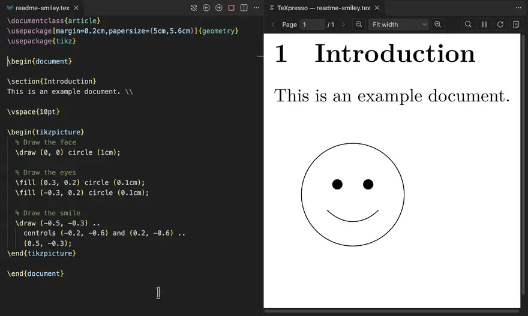
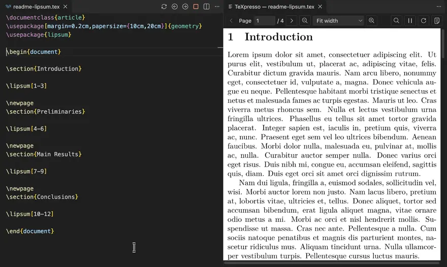
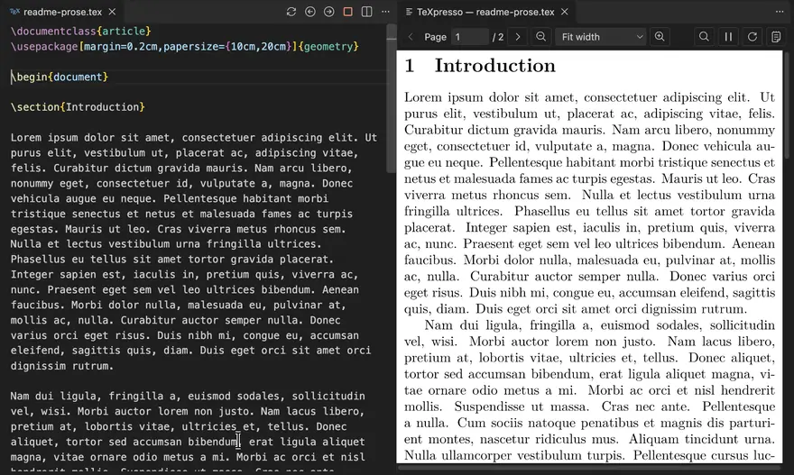
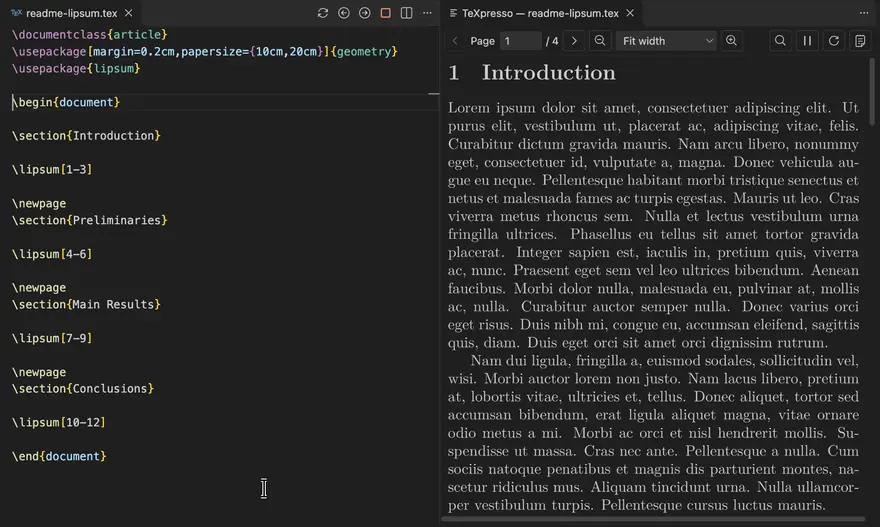
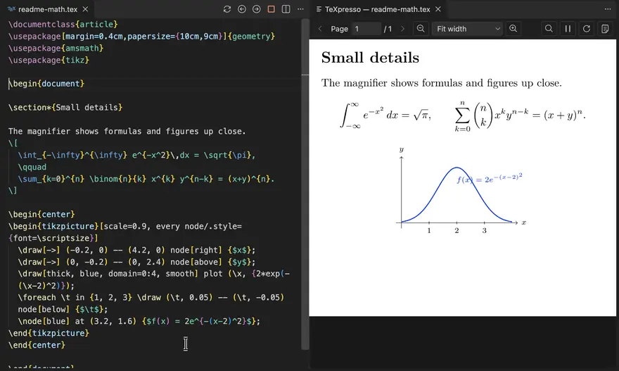

# TeXpresso VS Code Extension
Visual Studio Code extension for interacting with [TeXpresso](https://github.com/let-def/texpresso/), which provides a "live rendering" experience when editing LaTeX documents. **New**: Since version 2.0.0, the extension for macOS and Linux ships with a built-in TeXpresso, and offers a preview shown directly inside VS Code, next to your source. A similar experience is available on Windows through WSL. Instead of the built-in TeXpresso, you can continue to use your own TeXpresso instance.

To use this extension, open the `.tex` document you wish to edit, then start TeXpresso from the status bar. Alternatively, open the command palette (<kbd>Ctrl</kbd> + <kbd>Shift</kbd> + <kbd>P</kbd>), and select `TeXpresso: Start Document`. The preview opens beside your source. It immediately updates when you edit the file in VS Code, and using SyncTeX the preview automatically jumps to the current code position (and vice versa for Ctrl-clicks, or Cmd-clicks on macOS, in the preview). The toolbar at the top of the preview has buttons to switch pages, zoom, and pause or restart compilation, and a compile log for seeing compilation errors can be opened from there or found in the Output panel.

The extension can be used simultaneously with other LaTeX extensions such as [LaTeX Workshop](https://github.com/James-Yu/LaTeX-Workshop).

## Features

To change pages, use the buttons:

Use SyncTeX (forwards - editor to preview):

Use SyncTeX (backwards - preview to editor) by Ctrl-clicking (Cmd-clicking on macOS) in the preview:

Use theme colors in preview (if the `useEditorTheme` setting is activated):

Use the magnifier to look at details:

## Requirements

A TeX distribution must be installed: TeX Live (the default) or Tectonic (select it in the `texpresso.packageProvider` setting). The Linux versions require glibc 2.28 or newer.

Mac and Linux version have a built-in TeXpresso. The universal version of the extension does not include TeXpresso. In that case TeXpresso needs to be installed separately, following its [install guide](https://github.com/let-def/texpresso/blob/main/INSTALL.md), and must be callable at the path provided in the `texpresso.command` setting. Older versions of TeXpresso show the preview in a separate window instead of inside VS Code.

On Windows, we recommend opening your project in a [WSL](https://code.visualstudio.com/docs/remote/wsl) window: run `TeXpresso: Reopen Folder in WSL`, install the extension in that window, and install TeX Live or Tectonic in the Linux distribution. TeXpresso then runs in WSL while the preview appears in VS Code on Windows. Alternatively, from a normal Windows window, enable the `texpresso.useWSL` setting to use a separately installed TeXpresso in WSL (set `texpresso.wslDistribution` to choose a distribution other than the default one).

For projects with multiple files, add a `% !TeX root = main.tex` comment to the other files, or use `TeXpresso: Select Main Document`.

## Extension Settings

This extension contributes the following settings, among others:

* `texpresso.command`: The path to the TeXpresso binary. Leave empty to use the included one.
* `texpresso.packageProvider`: TeX Live (the default) or Tectonic.
* `texpresso.previewLocation`: Show the preview inside VS Code (Editor), in a separate window (Window), or choose automatically (Auto).
* `texpresso.renderingFormat`: Render the preview as PNG or SVG, or choose automatically (Auto, the default).
* `texpresso.syncTeXForwardOnSelection`: Controls whether the preview should be updated when the selection in the editor changes.
* `texpresso.useEditorTheme`: Controls whether the preview should use the same color theme as the editor.
* `texpresso.autoRerun`: Run additional passes (for references and the table of contents) when editing pauses.
* `texpresso.watchDependencies`: Refresh when project files change on disk.
* `texpresso.includeDirectories`: Additional directories for project inputs.
* `texpresso.useWSL`: Controls whether to run TeXpresso within Windows Subsystem for Linux (WSL).

## Troubleshooting

Run `TeXpresso: Check Setup` to see which TeXpresso binary and package provider are used. If compilation fails, look at the **TeXpresso** and **TeXpresso Log** output channels, and check that the required LaTeX packages are installed (inside WSL if you use it).

## Licensing and source

The extension's own code is MIT licensed. The platform-specific versions also contain native components under AGPL, GPL, LGPL and permissive licenses; see the [third-party notices](https://github.com/DominikPeters/texpresso-vscode/blob/HEAD/THIRD-PARTY-NOTICES.txt). License texts are included with the extension. Corresponding source archives and build instructions are available under the matching version in the [release downloads](https://github.com/DominikPeters/texpresso-vscode/releases).

## Development and Release Notes

See the [development guide](https://github.com/DominikPeters/texpresso-vscode/blob/HEAD/docs/development.md), the [native build guide](https://github.com/DominikPeters/texpresso-vscode/blob/HEAD/native/README.md), and the [changelog](https://github.com/DominikPeters/texpresso-vscode/blob/HEAD/CHANGELOG.md).
