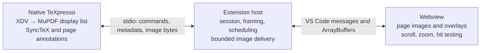

# Embedded TeXpresso preview

Status: PNG and outlined SVG previews, clipped high-DPI rendering, both SyncTeX
directions, source barriers, panel lifecycle, and Hyperref link overlays are
implemented. The toolbar selects PNG or SVG; PNG remains the default while the
formats are compared. Continuous scrolling and cross-page glyph reuse remain
future work. The current wire contract is
[documented with the engine](../native/texpresso/PREVIEW-PROTOCOL.md).

## Recommendation

Keep compilation, MuPDF display lists, and SyncTeX in the native TeXpresso
process. Add an optional headless viewer backend that exports requested pages
or page regions. The extension brokers requests and images; a webview owns
scrolling, zoom, page layout, and interaction overlays.

Support PNG and outlined SVG behind the same small image interface. Start the
vertical slice with PNG as the rendering reference, then compare SVG in the
actual webview before selecting the default. The measurements below make SVG
a strong candidate for ordinary text/math pages. Keep PNG for fidelity-sensitive
content and bounded region rendering at high zoom. Do not start with automatic
per-page format heuristics: first establish a reliable reference and measure
both paths. Begin afresh from the pinned upstream source; do not reuse
`web-wrapper-version`.



## Existing seams and necessary upstream changes

This design was checked against engine commit
`e8df7709077b2f86f6e16e6c86ceefb86de06f8d` in `native/texpresso`.

* `src/frontend/engine_tex.c:engine_render_page` already converts a completed
  live **XDV page** into `fz_display_list`. Both export formats can replay that
  list. There is no need to change XeTeX, wait for a completed PDF, or port MuPDF
  into JavaScript/WASM.
* `src/frontend/renderer.c` replays the display list into the visible SDL
  viewport and lazily creates structured text. Keep these responsibilities
  separate: an SDL texture is not the export boundary. The new exporter should
  use an RGB pixmap; the existing SDL BGR pixmap is unsuitable for the PNG API.
* `src/frontend/main.c:need_advance` currently advances compilation to the
  native viewer's current page or a pending SyncTeX target. In headless mode,
  the highest requested visible page becomes that demand target. Preserve
  on-demand compilation, pause/resume, dependency refresh, and convergence.
* `driver.c` always initializes SDL video and creates a window, and `main.c`
  mixes shared engine work with window operations. Introduce a narrow viewer
  boundary for page changes, repaint, navigation results, and lifecycle.
  Initially retain SDL events/timers for stdin wakeups and scheduling, skipping
  video/window/texture setup in headless mode. Guard the window-dependent setup,
  loop, reload, and shutdown paths. Do not duplicate the compiler/event loop or
  start by rewriting its scheduling infrastructure.
* `src/dvi/incdvi.c` knows completed-page offsets and rollback, but exposes no
  page revision interface. Add explicit invalidation notifications. A constant
  page count, unchanged display-list pointer, or unchanged XDV byte range is
  insufficient: images and fonts can change on disk.

Suggested engine additions are a pure MuPDF `page_export` helper, a small
viewer backend interface, headless startup, page availability/invalidation
events, render requests, and forward/inverse SyncTeX messages. Annotation
support is a separate patch series. The default SDL viewer keeps its existing
behavior and remains usable by other editors.

## PNG versus SVG: measurements

Offline macOS arm64 experiment, compact MuPDF 1.28.5 profile, seven warm
exports of one retained display list. All fixtures are single A4 pages. PNG
is 1600 × 2263 pixels (800 CSS pixels at DPR 2). SVG outlines text and reuses
image definitions. Times exclude loading the PDF and constructing the list.

| Fixture | PNG replay + encode | PNG | SVG export | SVG raw / gzip level 1 | gzip time |
| --- | ---: | ---: | ---: | ---: | ---: |
| Text and mathematics | 56.9 ms | 373 KiB | 1.7 ms | 332 / 44 KiB | 1.0 ms |
| Dense vector drawing | 67.9 ms | 200 KiB | 5.4 ms | 1298 / 167 KiB | 4.2 ms |
| Noisy synthetic raster | 62.8 ms | 982 KiB | 19.6 ms | 1042 / 803 KiB | 26.1 ms |

At 2400 pixels wide, PNG replay plus encoding took about 119–130 ms for
text/vector and 112 ms for the raster. SVG output is unchanged by raster width
in these fixtures. MuPDF's standard PNG compression, rather than text drawing,
dominates the text case. Gzip level 6 saves more SVG bytes but costs more CPU;
level 1 is a better initial latency tradeoff. Compressing embedded raster data
again has much less benefit.

An isolated Chrome 155 experiment loaded the same images as Blob-backed
`` elements at 800 CSS pixels, DPR 2. See the JSON snapshot for exact
browser timings. The final run decoded the text PNG in about 8 ms and SVG
in about 20 ms; dense-vector SVG took about 26 ms. The SVG decode penalty was
smaller than the native PNG encoding cost. These measurements support testing
SVG, rather than assuming PNG will be faster overall.

The fixtures enter MuPDF through PDFs to exercise the shared display-list
export boundary. They do not measure live XDV list creation, VS Code IPC,
remote latency, gzip decoding, peak memory, or a complete edit-to-preview
pipeline. Browser frame waits and canvas readback are separate diagnostics,
not values to add together as a predicted end-to-end latency. Reproduction:
[native/bench/README.md](../native/bench/README.md),
[recorded measurements](../native/bench/results-20261021.json).

### Format implications

**PNG** preserves native MuPDF raster output, gives predictable pixel budgets,
and supports clipped rendering naturally. It needs a new raster when zoom or
DPR changes. During a gesture, scale the last image immediately with CSS, then
request the latest sharper raster after a short debounce. Cache display lists
so zoom does not repeat XDV interpretation or compilation. Profile a faster
PNG compression option if this path becomes the default; do not assume the
current standard encoder is cheap enough for every keystroke.

**SVG** saves native rasterization/PNG compression and allows sharp zoom without
a native round trip for paths and glyphs. Use `FZ_SVG_TEXT_AS_PATH`; text output
can substitute fonts and change layout. Outlined SVG does not supply selectable
text or links. Embedded images stay raster, and MuPDF rasterizes some shadings
at an export resolution, so SVG is not universally resolution-independent.
The SVG device also has limitations around group/knockout semantics; included
PDFs, masks, transparency, clipping, and blend modes need fidelity comparisons.
Large SVGs have parsing, geometry, and browser raster costs even when compressed
bytes are small.

Load SVG as an isolated Blob-backed ``, with an explicit white page
background, rather than injecting document markup into the webview DOM. Keep
interaction overlays outside the image. Bound uncompressed SVG bytes and
embedded resources; switch to PNG if a page exceeds the vector budget, fails
to decode, or needs a supported raster-only fidelity path. Initially expose
format selection to the development harness; establish detection/user override
behavior before shipping automatic fallback for rendering differences.

### Glyph reuse across pages and updates

MuPDF already deduplicates outlined glyphs **within an SVG device/page**. Its
SVG device tracks `(fz_font *, glyph ID)`, emits a definition once, and places
`<use>` references for occurrences. The text fixture already has 64 outline
definitions serving 2,701 uses. The measured SVG sizes therefore include this
optimization; repeating the complete outline for every character is not the
baseline.

Definitions are emitted again by each new device. The public `id` option keeps
generated IDs unique across outputs; it does not retain font identities or
the glyph sent-set across devices. A persistent resource store is a further
optimization, with a meaningful text-page saving. Removing all simple glyph
definitions from the existing fixtures, then gzip-compressing at level 1:

| Fixture | Self-contained SVG | Warm body without glyph definitions |
| --- | ---: | ---: |
| Text/math | 43.6 KiB | 21.7 KiB |
| Dense vectors | 167.2 KiB | 162.2 KiB |
| Noisy raster | 803.4 KiB | 797.8 KiB |

This is a transfer-size estimate for a fully warm glyph cache, excluding
dictionary messages/identifiers and new glyphs, not a working delta renderer
or a memory/speed measurement. Reproduce with `native/bench/glyphs.py`.

Two distinct designs are possible:

1. **Reuse transmitted definitions, keep isolated images.** At the
   extension-to-webview boundary, split the generated SVG structurally into
   reusable definitions and page content, hash/remap reusable glyph resources,
   and send only definitions missing from the receiver. The webview reconstructs
   a self-contained SVG Blob from its cache. This can preserve ordinary MuPDF
   output and avoid any initial MuPDF patch; the native-to-extension local pipe
   still carries the complete SVG. The remote extension-to-webview path is where
   transfer savings matter most. Account for XML parsing/recompression cost.
   It saves transfer bytes but still duplicates definitions inside each decoded
   image and does not avoid browser parsing of the reconstructed document.
2. **Reuse live browser glyph resources.** Inline SVG pages can reference shared
   `<defs>` in the same document, retaining parsed geometry. That changes the
   isolation model and adds DOM/resource lifetime management. Separate SVGs
   loaded as `` cannot reference a shared parent-document `<defs>`;
   external-resource restrictions also prevent treating an external glyph atlas
   as a portable drop-in for image mode. Do not rebuild the prototype's custom
   drawing-command renderer merely to obtain this optimization.

Prefer the first as a later measured optimization. Define resource IDs by
content or explicit resource generations, not raw font pointers. Bound caches,
handle eviction and webview recreation with acknowledged resource epochs, and
keep complex Type 3 glyphs/resources self-contained initially. A native shared
SVG-resource API could later avoid repeated outline generation too, but the
current ~1.7 ms text export is a much smaller cost than PNG compression. There
is no need to maintain a MuPDF fork for this before measuring the complete path.

## Transport and scheduling

Use the existing stdin/stdout channel, with **opt-in binary output framing**.
Continue using JSON lines for commands and notifications. An image header is
a JSON line followed by exactly `byteLength` raw bytes; parsing then returns
to JSON-line mode. Never send binary frames to an unmodified editor client.
Tentative names and one PNG response:

```json
["page-image", {"requestId":42,"sessionId":"s1","documentRevision":17,"pageVersion":8,"page":2,"bounds":[0,0,595.28,841.89],"clip":[0,0,595.28,841.89],"scale":2.6877,"pixelBounds":[0,0,1600,2263],"mime":"image/png","encoding":"identity","byteLength":381529}]
```

The header above is illustrative, not a frozen wire specification. Replies
carry the accepted request ID and snapshot identity. SVG uses the same page
coordinates, MIME `image/svg+xml`, and optional `encoding: gzip` with an explicit
uncompressed byte length; pixel fields are raster-specific. Include the actual
affine page-to-pixel transform when
clipping/rotation make a scalar inadequate. Define image origin and integer
rounding in the protocol, rather than deriving them independently in two places.

One stdout writer must serialize complete headers and bodies, with no log or
notification interleaving inside a body. Flush after a frame. Stderr remains
text. The extension uses a chunk-aware byte parser instead of `readline` in
this mode: never UTF-8-decode an image body. Validate header size, MIME,
integer lengths, finite coordinates, dimensions, and negotiated budgets before
allocating. A malformed or oversized frame terminates the protocol session;
searching arbitrary image bytes for a new JSON line cannot safely resynchronize.

Pass an exact-sized `ArrayBuffer` through `webview.postMessage`; the extension's
minimum VS Code version supports efficient ArrayBuffer delivery. Avoid JSON
base64, whose extra bytes and string allocations serve no purpose here. The
webview decompresses gzip SVG with `DecompressionStream`, enforcing an expanded
byte limit, before creating its image Blob. This keeps compressed bytes on the
remote message path; PNG is not compressed again. It makes a Blob URL, waits
for `img.decode()`, swaps the image, acknowledges the request, and revokes
obsolete URLs. VS Code does not promise zero-copy
delivery, and `postMessage(true)` is not a receipt/decode acknowledgment.

The extension owns scheduling: one active image delivery and one replaceable
pending viewport request initially. Prioritize explicit forward SyncTeX and
visible pages over prefetch. Cancel queued obsolete work and discard stale
responses. Always drain stdout, including bodies that will be discarded;
otherwise an image can block compiler output and command processing. Browser
ready/decoded messages carry a webview-instance ID so late acknowledgments
cannot grant credit to a recreated panel. Hiding/disposing a panel cancels
delivery credit and queued renders without waiting for a missing acknowledgment;
on restoration, wait for ready and request the current viewport. A decode error
or timeout must also release resources and resolve the pending delivery state.

Stdio avoids a server, port forwarding, and cross-filesystem temporary image
handoffs. It also fits `wsl -e` and remote extension hosts conceptually, but
Windows/WSL binary round trips must be tested, including NUL, CR/LF, arbitrary
chunk splits, and EOF inside a body. A separate inherited descriptor would
complicate the existing Windows-to-WSL launch path. Temporary files through
`asWebviewUri` remain a possible fallback if measured VS Code message overhead
warrants one; do not implement both transports initially.

## Page snapshots, zoom, and memory

Use a new session ID for every native process, a document revision for each
invalidation, and page versions for reusable snapshots. Render requests name
the expected page version; images, metadata, links, and hit tests refer to that
same version. If edits have invalidated it, reject the hit test or request the
new page. Never interpret coordinates from an old image using a newer SyncTeX
map. While updating, retain the last good image but disable stale interactions.

Invalidate conservatively on rollback, aux rerun, rescan, and external resource
changes. Once correct, preserve completed prefix pages before the earliest
affected page, including their metadata. Source edits need an explicit sequence
barrier/acknowledgment so a render cannot be mistaken for including commands
that the engine has not consumed yet. Avoid using source edit counts alone as
page versions: a single edit can produce several incremental page updates.

Send lightweight availability, page size, and invalidation metadata without
eagerly exporting every page. The number of completed pages is a lower bound
until the engine reaches the end. Display `3 / …` where appropriate, and allow
requesting the next page to advance compilation. Continuous scroll should
virtualize page images while retaining cheap layout placeholders; an unseen
document should not trigger hundreds of render requests just to learn its total.

Initial configurable-in-code budgets, to be tuned with real measurements:

* Keep display lists for the current page and at most two neighboring pages;
  cap the MuPDF resource store separately. The existing `FZ_STORE_DEFAULT`
  is 256 MiB and is a cache limit, not a total process memory limit.
* Cap each raster at roughly 4 megapixels for normal interactive requests.
  At high zoom, request the visible page-space region plus a small margin,
  clipped to page bounds. If needed, subdivide into fixed-size tiles with a
  shared transform and slight overlap to prevent seams. An 8-megapixel whole
  page is not a sensible default simply because the PNG is only a few KiB.
* Bound aggregate visible decoded pixels as well as individual images. Two
  resident 1600 × 2263 RGBA pages consume about 27.6 MiB for their pixel data
  alone; native RGB buffers, decode/swap overlap, IPC copies, and GPU textures
  add to that. Evict offscreen images/bitmaps and old encoded buffers promptly.
* Cap encoded image and uncompressed SVG size separately (initially 8 MiB
  and 16 MiB per frame), with a bounded aggregate encoded cache. Size limits
  alone cannot predict SVG geometry cost, so measure browser paint/scroll and
  retain raster override. At extreme zoom use clipped raster output even if
  the normal view is SVG; do not rely on browser SVG surfaces staying small.
* Suspend rendering and prefetch when hidden. Restore page, zoom, and scroll
  anchor with `getState`/`setState`; do not retain the hidden DOM by default.

Initially export serially at safe points between engine steps. The DVI context
is mutable and must not be read concurrently with compilation/rollback. A
retained display list is the boundary for any later render worker: add cloned
MuPDF contexts, the required locks, and explicit resource lifetime rules before
threading. A canceled request can initially be dropped before work or after
completion; this is not preemption of an already running synchronous encoder.
Measure latency before adding that complexity. Budgets bound added preview
resources, not XeTeX's existing incremental process snapshots or total RSS.

## SyncTeX, hyperlinks, and text

Use one canonical coordinate system: the top-left-oriented MuPDF page space
in points, with an explicit page bounding box and orientation. CSS pixels,
device pixels, crop offsets, scrolling, and zoom are view transforms. Browser
hit tests invert that transform; the engine handles the existing
`scale_factor` conversion to/from its integer SyncTeX coordinates. Pages are
zero-based on the wire. Preserve the extension's existing file/path and source
line/column conversions rather than inventing another mapping layer.

Inverse SyncTeX is a small request `(snapshot, page, point)` that calls the
existing native `synctex_scan`, then uses the existing editor-navigation
notification. Forward SyncTeX keeps the current source command and adds a
native reply `(snapshot, page, point)`; optionally include a highlight rectangle
when available. Reveal, pan, and highlight in the webview without regenerating
the page image. There is no need to transmit the entire SyncTeX database.

Hyperref requires additional native work. The current DVI special parser does
not collect links or destinations, and exporting a display list to SVG cannot
restore that information. This is a focused extension to the existing DVI/XDV
interpreter, not a new DVI parser. Ordinary internal links and HTTP(S) links
should be manageable; geometry and incremental invalidation need careful tests.
A locally compiled XeLaTeX example emits:

```text
pdf:dest (target) [@thispage /XYZ @xpos @ypos null]
pdf:bann<</Type/Annot/Subtype/Link/.../A<</S/URI/URI(https://example.org)>>>>
pdf:bann<</Type/Annot/Subtype/Link/.../A<</S/GoTo/D(target)>>>>
pdf:eann
```

Add a structured annotation collector beside DVI drawing. Parse the supported
dictionary subset with proper nesting/string escaping, not substring matching.
Track transformed annotation geometry, including glyph/rule advances inside
begin/end ranges, multiline fragments, explicit dimensions, and destinations;
begin/end cursor positions alone do not define a reliable link rectangle.
Publish rectangles and link actions in page space. Version destinations and
invalidate them on rollback too; a forward destination may be unresolved until
its page is compiled. Resolve that demand through the normal compiler scheduler;
finding a destination whose page is unknown may require advancing to end of
document. Do this for explicit navigation, not for every unresolved link overlay.

The webview renders accessible interaction overlays. Normal click follows a
link; modified click performs inverse SyncTeX. The extension validates external
HTTP(S) targets and opens them through VS Code; internal targets reveal a page
and point. Other action schemes need an explicit supported policy. Never copy
PDF/TeX actions into executable HTML. Links embedded inside an included PDF
graphic would require their own transformed annotation extraction; they are
separate from top-level hyperref support.

### Prototype findings

The local `/Users/dominik/GitHub/texpresso` prototype (`web-wrapper-version`,
including its working changes) and the extension's `websockets` branch
(`0aaad6fa8e61775dc8b1232eb5e63adcba90e89f`) were inspected on 2026-10-22.
The native prototype has the right broad hooks: `pdf:dest/bann/eann` in
`dvi_special.re2c.c`, bounds collection in `dvi_prim.c`, movement hooks in
`dvi_interp.c`, and a destination/annotation registry in `hyperlink.c`.
The extension prototype renders link overlays and maintains shared glyph
definitions. These are useful examples and test-case sources; performance
problems in the full prototype are not evidence that annotation collection
itself is expensive. That would require profiling.

Implement these pieces afresh rather than porting them mechanically. Examples
of issues in the inspected native implementation are action-dictionary
substring matching, a pop/vertical-movement heuristic for splitting links,
two-corner bounding-box transforms (insufficient under general rotation/shear),
and silently dropping annotations beyond a fixed capacity of 32 fragments.
`hyperlink_rollback` is defined but has no call site; truncation therefore needs
real integration, not just a helper. Destinations are discovered during page
replay, so forward links must arrange to interpret relevant pages, not merely
compile more bytes. Keep that metadata work independent of image export.

Copy/search/accessibility can later request structured text lazily from the
same display list. MuPDF already serves native text selection this way. This
needs its own Unicode, math, ligature, and reading-order tests; outlined SVG
does not make a selectable text layer automatic. Keep text metadata separate
from the initial SyncTeX implementation.

## Extension and UI integration

Keep `TexpressoSession`, document synchronization, dependency watching, logs,
and process cleanup. Add a transport/parser abstraction to `EngineProcess`, a
`PreviewController` for one panel per existing session, and a browser-only
viewport/image controller. The session emits typed preview events; it should
not manipulate webview HTML. Existing source synchronization tests can exercise
either backend through the same session boundary.

Use a `WebviewPanel` beside the editor, not a custom editor replacing the TeX
source. Set HTML once and update with messages. Provide page navigation, fit
width/page, zoom, and source-sync controls with keyboard access; reuse restart,
pause, status, and output actions from the session. Preserve editor focus on
automatic updates. Keep the last successful page visible on a compiler error,
with a concise status/action opening the relevant output. Closing the preview
stops that session using the existing cleanup path; hiding its tab only suspends
image delivery. Use VS Code theme tokens for chrome, keeping document color
handling separate from toolbar styling.

A location setting can offer `auto`, `editor`, and `window`: `auto` prefers a
capable embedded backend; explicit `editor` explains missing support with an
engine-selection/update action. Add a cheap capabilities probe that exits
before SDL/document startup, rather than guessing features from release
versions. Advertise protocol version, codecs/encodings, clipped rendering,
SyncTeX directions, and annotation support separately. Use the bundled manifest
as provenance, and runtime capabilities as the contract for installed builds.
Old engines continue to support the existing external viewer.

The extension stays with the workspace/engine host in Remote SSH, containers,
and WSL; the webview stays with the UI. Use `asWebviewUri` for packaged scripts
and styles, a restrictive CSP allowing the required Blob images, and narrow
resource roots. Validate all webview messages; open source files through the
session's existing path mapping. This also permits a browser VS Code client
backed by a remote native extension host, without requiring a WASM engine.

## Implementation sequence and acceptance checks

1. **Native seam and capabilities.** Extract viewer operations, add headless
   startup and the probe, preserve SDL behavior. Prove no window/display server
   is required; rerun existing real-engine lifecycle/convergence/sync tests.
2. **One-page vertical slice.** Binary framing, PNG render, panel lifecycle,
   page navigation, fit/zoom, both SyncTeX directions, explicit revisions and
   resource limits. Test adversarial stream chunking/lengths, image-body EOF,
   unsupported engines, hidden/closed panels, and process restart.
3. **SVG comparison and bounded viewport.** Add outlined SVG/gzip and actual
   webview A/B measurements; compare included PDFs, custom fonts, CJK, math,
   raster graphics, masks/transparency, rotation, and very dense drawings.
   Implement viewport clipping/high-zoom raster, page virtualization, stale
   response disposal, and prefix invalidation. Test zoom/DPR changes, mixed
   page sizes, crop offsets, and edits during scrolling/inverse SyncTeX.
4. **Links.** Add independently testable DVI annotation parsing and geometry,
   named destinations, invalidation, and overlays. Include wrapped links,
   nested transforms, escaped URLs, unsupported actions, and pending targets.
5. **Choose defaults.** Measure real edit-to-visible p50/p95, fast typing under
   rendering load, native/extension/browser/GPU memory, and repeated zoom/scroll
   without resource growth. Test local, Remote SSH, and Windows/WSL. Set codec,
   cache, and pixel defaults from those results; consider a worker or faster
   PNG compression only where a measured bottleneck remains.

Each engine step belongs on a focused feature branch based on the maintained
`vscode` fork branch, with independent tests. Push tested engine changes before
updating the extension gitlink. The initial embedding should not depend on a
new compiler format, a second PDF pipeline, or the historical web wrapper.

## References

* [Pinned engine source](https://github.com/DominikPeters/texpresso/tree/e8df7709077b2f86f6e16e6c86ceefb86de06f8d/src)
  — frontend engine, renderer, SyncTeX, and DVI special handling inspected locally.
* [MuPDF SVG device API](https://github.com/ArtifexSoftware/mupdf/blob/8ad45e92f0935d3d87f1db3f873086472a5e1b24/include/mupdf/fitz/output-svg.h)
  — text paths versus font-dependent text and raster shading resolution. See
  the same revision's `source/fitz/svg-device.c` for group limitations.
* [VS Code webviews](https://code.visualstudio.com/api/extension-guides/webview)
  — panels, lifecycle, state restoration, CSP, and resource URIs.
* [VS Code 1.88 API declarations](https://github.com/microsoft/vscode/blob/1.88.0/src/vscode-dts/vscode.d.ts)
  — `Webview.postMessage` ArrayBuffer support and delivery semantics.
* [Remote webviews](https://code.visualstudio.com/api/advanced-topics/remote-extensions#using-the-webview-api)
  — UI/workspace separation and message passing across remote hosts.
* [SVG image restrictions](https://developer.mozilla.org/en-US/docs/Web/SVG/Guides/SVG_as_an_image#restrictions)
  — isolated image contexts cannot load external resources as ordinary inline
  SVG documents can.

## SVG device audit and initial fallback policy

Audited the bundled MuPDF 1.28.5 source, especially
[`svg-device.c`](https://github.com/ArtifexSoftware/mupdf/blob/8ad45e92f0935d3d87f1db3f873086472a5e1b24/source/fitz/svg-device.c)
and [`util.c`](https://github.com/ArtifexSoftware/mupdf/blob/8ad45e92f0935d3d87f1db3f873086472a5e1b24/source/fitz/util.c).
The preflight replays the retained display list into a small inspection device;
it does not decode images, outline glyphs, rasterize, or repeat XDV parsing.

| Feature | Source finding | Current behavior |
| --- | --- | --- |
| Transparency groups | `svg_dev_begin_group` ignores isolation/knockout and emits CSS mix-blend-mode; it does not reproduce arbitrary PDF blending spaces. | PNG for non-isolated or knockout groups, non-normal blends, and non-RGB/Gray blending spaces. Isolated normal RGB/Gray opacity groups remain SVG. |
| Soft masks | `svg_dev_begin_mask` initializes luminosity masks to white and does not preserve arbitrary PDF backdrop color/bounds semantics. | PNG for soft masks. |
| Images | `svg_send_image` delegates to `fz_append_image_as_data_uri`; compressed JPEG/PNG paths can copy original bytes without PDF mask/decode/color-key handling or a PDF-specified color-space conversion. | PNG when a mask, decode array, color key, or non-device RGB/Gray color space is present; ordinary images may remain embedded raster data in SVG. |
| Shadings | `svg_dev_fill_shade` allocates a pixmap at `raster_scale` and embeds it. | PNG, retaining viewport-aware raster quality and pixel limits. |
| Tiling patterns | SVG export synthesizes repeated tiles and documents pathological repetition/viewer costs. | Conservative PNG fallback until measured separately. |
| Type 3 fonts / overprint | Type 3 glyph programs can hide unsupported graphics; SVG color operations do not reproduce print overprint semantics. | PNG. Normal fonts are outlined and reused within the page. |
| Resource limits / themes | SVG parsing and embedded resources are distinct from raster pixel count; native preview recoloring happens after rasterization. | Bounded vector preflight, 16 MiB output cap, large-image/page checks, PNG for recolored themes or failed exports. |

Fallback is per page and preserves the requested SVG selection; the status line
explains why the actual frame is PNG. A failing browser SVG decode also retries
PNG. The engine tests compare a transparency-page fallback byte-for-byte with
the explicit PNG reference. Native device tests cover normal vectors, isolated
opacity, non-isolation, knockout, and blending. The device callback signature is
compatible with both CI's MuPDF 1.23 and the bundled 1.28.5.

Hyperlink geometry is collected while the existing DVI interpreter processes
specials and paints text/rules/images. The destination-page index is built by
the existing incremental opcode scan and rolls back with changed XDV. Named
links request compilation up to their target without exporting intermediate
pages. Link overlays live outside both image codecs; plain click follows a
link, Control/Command click retains inverse SyncTeX, and magnifier mode leaves
pointer input on the page. External HTTP(S)/mailto links are validated by the
extension host against current engine metadata before VS Code opens them.
